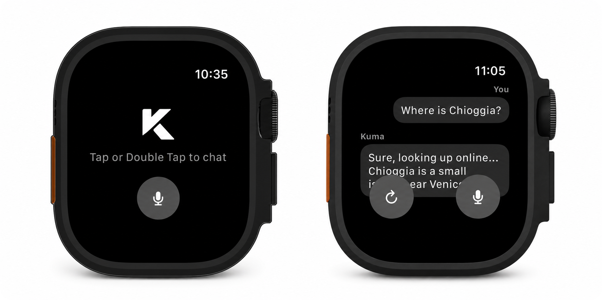

# Kuma Voice

<p align="center">
  
</p>

Kuma Voice is a self-hosted, watch-only voice assistant prototype. The Watch
streams microphone audio to a FastAPI backend, which keeps provider credentials
off the device and streams a spoken answer back. Optional tools add web search,
Notion notes, and Google Calendar access.

This repository does not include a public backend or any credentials. Run your
own server and point the Watch app at it.

## Project layout

- `watchos/KumaVoice.xcodeproj` — watch-only SwiftUI app
- `backend/app` — FastAPI server and provider integrations
- `backend/tests` — tests that use fakes and do not consume API credits

## Requirements

- Xcode 16 or later and an Apple Watch simulator or device
- Python 3.12 or later
- [uv](https://docs.astral.sh/uv/)
- An OpenAI API key for the realtime voice flow

OpenRouter powers the older REST fallback. Exa, Notion, and Google Calendar are
optional.

## Start locally

```sh
cd backend
cp .env.example .env
uv sync
```

Add at least this value to `backend/.env`:

```dotenv
OPENAI_API_KEY=your-key-here
```

Then start the server:

```sh
uv run uvicorn app.main:app --host 0.0.0.0 --port 8000 --reload
```

The liveness check is at
[`http://127.0.0.1:8000/health`](http://127.0.0.1:8000/health), and local API
documentation is at [`http://127.0.0.1:8000/docs`](http://127.0.0.1:8000/docs).

## Run the Watch app

1. Open `watchos/KumaVoice.xcodeproj` in Xcode.
2. Select the `KumaVoice` target and choose your development team under
   Signing & Capabilities.
3. Start the backend, select an Apple Watch simulator, and press Run.
4. Tap the microphone button, or use Double Tap on supported hardware, to start
   and stop a turn.

The checked-in configuration uses `http://127.0.0.1:8000`. For a physical Watch
or hosted server, create a private local configuration:

```sh
cp watchos/Local.xcconfig.example watchos/Local.xcconfig
```

Edit `watchos/Local.xcconfig` with your own HTTPS backend URL. If the backend has
an API token, put the same value in `KUMA_API_TOKEN`. This file is ignored by
Git. Local HTTP is allowed for development; remote deployments must use HTTPS.

## Protect an internet-facing backend

`KUMA_API_TOKEN` is optional only for local development. If it is empty, the API
accepts requests without authentication. Always set a long random value when the
server is reachable from the internet, then put the same value in the ignored
Watch configuration described above.

The token protects every `/api/v1` HTTP and WebSocket endpoint. `/health`
remains public but returns only `{"status":"ok"}`. This is lightweight shared-
secret protection for a personal prototype, not multi-user authentication.

## Deploy to Fly.io

The included `fly.toml` deliberately contains no app name or personal region.
Choose your own globally unique name:

```sh
KUMA_FLY_APP=your-unique-app-name
fly auth login
fly apps create "$KUMA_FLY_APP"
fly secrets set -a "$KUMA_FLY_APP" OPENAI_API_KEY=... KUMA_API_TOKEN=...
fly deploy -a "$KUMA_FLY_APP"
```

Set `KUMA_BACKEND_URL` in `watchos/Local.xcconfig` to your assigned HTTPS URL,
then rebuild the Watch app. Use `openssl rand -hex 32` to generate a suitable
token and keep it in a password manager.

## Optional integrations

Provider secrets belong only in `backend/.env` locally or in your host's secret
store. The full list and safe placeholders are in `backend/.env.example`.

### Web search

Set `EXA_API_KEY` to let the realtime assistant search the web.

### Notion

1. Create an internal integration at
   [notion.so/my-integrations](https://www.notion.so/my-integrations).
2. Share only the pages Kuma should access with that integration.
3. Set `NOTION_API_KEY` and, optionally, `NOTION_NOTES_PAGE_ID`.

### Google Calendar

1. Enable the Google Calendar API and create a Desktop OAuth client in the
   [Google Cloud Console](https://console.cloud.google.com/).
2. Set `GOOGLE_CALENDAR_CLIENT_ID` and `GOOGLE_CALENDAR_CLIENT_SECRET` locally.
3. Run `uv run python -m scripts.google_calendar_auth` from `backend` and save
   the resulting `GOOGLE_CALENDAR_REFRESH_TOKEN`.
4. Set `GOOGLE_CALENDAR_TIMEZONE` to an IANA zone such as `UTC`.

Use a dedicated test calendar and least-privilege Notion pages when evaluating
the prototype.

## Privacy notes

Microphone audio and conversation content are sent to the providers configured
on your backend. Web searches, notes, and calendar requests may also be sent to
their respective services. Review those providers' retention settings before
using personal or sensitive data.

Never commit `backend/.env` or `watchos/Local.xcconfig`. If a credential is ever
exposed, rotate it rather than merely deleting it from Git.

## API endpoints

- `GET /health` — minimal liveness response
- `WS /api/v1/realtime` — realtime PCM voice conversation
- `POST /api/v1/transcriptions` — audio file to text
- `POST /api/v1/responses` — messages to assistant text
- `POST /api/v1/speech` — text to MP3 audio
- `POST /api/v1/conversations` — start an in-memory conversation
- `POST /api/v1/conversations/{id}/turns` — run a complete voice turn
- `DELETE /api/v1/conversations/{id}` — end a conversation

Conversations are kept only in memory and disappear when the backend restarts.
Realtime audio is 24 kHz mono, 16-bit PCM.

## Tests

```sh
cd backend
uv run pytest
```

## License

[MIT](LICENSE)
